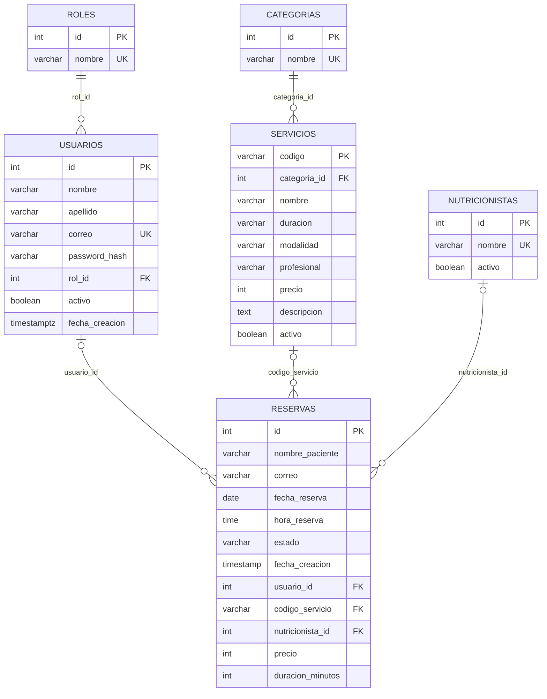
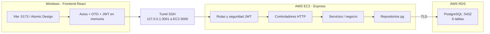

# Diagramas de NutriVida - Guía 19

Estos tres diagramas corresponden al código del backend `main` y el frontend `guia20-axios-dto`. También se incluyen versiones visuales editables `.drawio` dentro del ZIP de entrega.

## Modelo entidad-relación



## Arquitectura del sistema



## Inicio de sesión y JWT

```mermaid
sequenceDiagram
    autonumber
    actor P as Paciente
    participant R as React
    participant API as Express
    participant S as Servicio autenticación
    participant DB as PostgreSQL
    P->>R: Ingresa correo y contraseña
    R->>API: POST /api/auth/login (DTO)
    API->>S: Validar datos y límite de intentos
    S->>DB: Buscar usuario por correo
    DB-->>S: Hash, estado y rol
    alt Credenciales correctas y cuenta activa
        S->>S: Verificar Argon2id y emitir JWT HS256 (30 min)
        S-->>API: accessToken, expiresIn, usuario
        API-->>R: HTTP 200
        R->>R: Guardar token solo en memoria
        R->>API: GET /api/reservas con Bearer JWT
        API->>API: Verificar firma, exp, iss, aud
        API->>DB: Comprobar cuenta y rol
        DB-->>API: Perfil vigente
        API-->>R: HTTP 200: reservas del paciente
    else Credenciales incorrectas
        S-->>API: Fallo de autenticación
        API-->>R: HTTP 401
    end
    Note over R,API: Token ausente/inválido: 401; rol sin permiso: 403
```

## Notas técnicas

- La tabla `reservas` tiene campos de asociación (`usuario_id`, `codigo_servicio`, `nutricionista_id`) que pueden ser nulos en el esquema actual para preservar datos antiguos. Las reservas nuevas se validan en el servicio.
- Para la demostración, el frontend en Windows usa un túnel SSH hacia Node/Express en AWS EC2. No se ha implementado una exposición HTTPS pública.
- El token JWT tiene una vigencia de 30 minutos, se guarda en memoria de React y el backend vuelve a validar la cuenta y los permisos para rutas protegidas.
- Fuentes del modelo: `sql/schema.sql`, `sql/relaciones.sql`, `sql/duracion_reservas.sql` del backend; autenticación: `src/seguridad/tokens.js`, `src/seguridad/autenticacion.js`, `src/servicios/autenticacion.servicio.js` y `src/context/AutenticacionProvider.jsx` del frontend.
